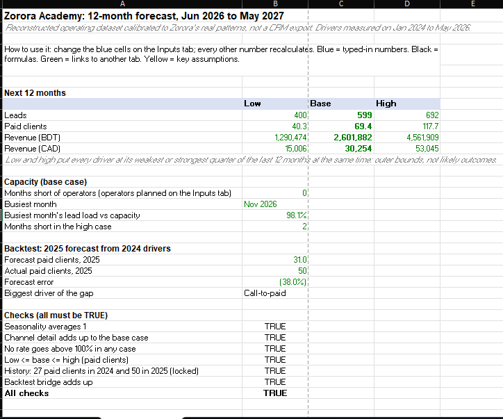

# Zorora Forecast

A driver-based forecast for Zorora Academy, a study abroad consultancy in Dhaka. It answers
three questions for the next 12 months: how many clients will pay, what revenue that brings,
and whether one intake operator can handle the busiest months.

## What it does
- Forecasts leads by channel through triage, diagnostic calls and payment to paid clients and revenue, by month, with low, base and high cases.
- Checks capacity: how many operators each month needs.
- Backtests the method: 2024's drivers forecast 2025, and a bridge explains the gap.
- Answers plain-English what-if questions, such as "what if Facebook leads drop 20% in November and December?"

## How the AI is kept in check
- The AI turns a question into lever changes, and code rejects anything outside a set range.
- The model calculates every result. The AI writes placeholders and code fills in the figures.
- A person approves each scenario and note, and approval re-runs the model to confirm the figures still match.

## Checks
26 locked-number checks pass before anything is built, and a Python copy of the model must
match the Excel workbook on 99 figures.

**Built with:** Excel (live formulas), Python (pandas, openpyxl), Claude API

## Data
A reconstructed operating dataset calibrated to Zorora's real patterns, not a CRM export:
1,458 leads from June 2023 to May 2026. Names are removed, operators appear only as roles,
and revenue and prices are scaled by undisclosed factors for confidentiality. Counts and
rates are unchanged.

## More
- [One-page summary](docs/writeup.md)
- [Technical details](docs/technical.md): how to run it, workbook tabs, how the AI is used and change log
